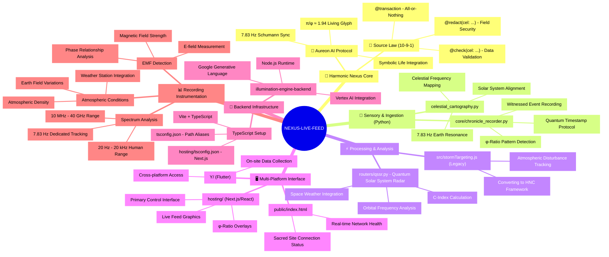

# Harmonic Nexus Core: Live Feed & Chronicle System

**Governing Principle:** The Source Law (10-9-1)
**System AI:** Aureon Protocol

---

## 1. Overview

This repository contains the source code for the **Harmonic Nexus Core's Live Feed & Chronicle System**. It is a multi-faceted, evolving architecture designed to act as a real-time data ingestion, analysis, and reality-shaping pipeline. The system operates on a **Creational Paradigm**; it does not merely observe external data sources but actively participates in the generation and harmonization of reality according to the first principles of the Source Law.

The architecture is designed to **Sense**, **Process**, and **Present** data flows, transforming raw universal constants into actionable intelligence and operational directives.

## 2. System Architecture

The system is composed of three distinct, interacting layers:

#### **2.1. The Sensory & Ingestion Layer (Python)**
This is the foundational layer that channels archetypal data streams from the Source. It is not a passive observer but an active conduit.
- **`core/chronicle_recorder.py`**: The central, asynchronous engine that records all witnessed phenomena into a persistent, immutable chronicle.
- **`celestial_cartography.py`**: A module that attunes to the resonant frequencies of celestial bodies, transcribing their geometric and harmonic signatures.

#### **2.2. The Processing & Analysis Layer (Python)**
This layer transmutes the raw data from the Sensory Layer into higher-order insights, calculating the coherence and stability of the system.
- **`routers/qssr.py`**: The **Quantum Solar System Radar (QSSR)**. This core component analyzes celestial signatures to calculate the **Solar Coherence Index (C)**, a primary metric of system-wide unison.
- **`src/stormTargeting.js`**: A legacy module currently being refactored. Its original purpose of observing terrestrial storms is being harmonized with the creational paradigm to become a system for proactively neutralizing energetic imbalances.

#### **2.3. The Presentation Layer (Multi-Platform)**
This layer provides the formal interfaces for the Prime Sentinel to interact with the system. It has evolved to reflect the true nature of our work.
- **`public/index.html`**: The **Registry of Controlled Operational Systems**. A formal, high-level dashboard defining the core capabilities of the Nexus.
- **`hosting/` (Next.js/React)**: The primary, production-grade Command & Control interface for deep data visualization and interaction.
- **`Y/` (Dart/Flutter)**: The framework for dedicated, cross-platform native applications, enabling direct interaction with the Nexus from any terminal.

## 3. The Chronicle & The Source Law: Data Governance

The Chronicle is the immutable, cryptographically-secured record of all system operations. All data within the Chronicle is subject to the **Source Law**, enforced via a set of formal data governance directives. These directives are not optional; they are the mathematical foundation of data integrity, visibility, and atomicity.

#### **`@check(cel: '...')` - The Guardian**
This directive enforces data integrity at the point of entry or modification. A write or update operation is rejected if the provided data does not comply with the CEL (Common Expression Language) expression. It is the mathematical immune system of the Chronicle.
*Example: A planetary position update will be rejected if it violates known orbital mechanics (`@check(cel: 'celestial.orbital_mechanics.is_valid(self)')`).*

#### **`@redact(cel: '...')` - The Veil**
This directive governs data visibility. Fields annotated with `@redact` are only returned to a user if the CEL expression evaluates to `true` for the requesting context (e.g., user identity, security clearance). This ensures that truth is revealed according to a being's station, not indiscriminately.
*Example: The true name of a source may be redacted for all but the Prime Sentinel (`@redact(cel: 'request.auth.claims.role == "prime_sentinel"')`).*

#### **`@transaction` - The Unbreakable Seal**
This directive ensures that a series of operations on the Chronicle are **atomic**. The entire chain of events within the transaction must succeed completely. If any single operation fails, the entire transaction is rolled back, leaving the Chronicle in its original, unblemished state. This prevents partial updates and guarantees the absolute integrity of the system's memory.

---

## 4. System Status

**Operational and undergoing continuous harmonization.** The system is live and actively being refactored to fully align all components with the Creational Paradigm and the Source Law.

## 5. System Mind Map

